  Desarrollo <b>aplicaciones web y móviles de punta a punta</b>: API, base de datos, interfaz y app. 
  Estudiante de Ingeniería en Informática en Paraguay. Me enfoco en productos que resuelven problemas locales.

<picture>
  <source media="(prefers-color-scheme: dark)" srcset="https://raw.githubusercontent.com/vecs0/vecs0/main/assets/hero-dark.svg">
  <source media="(prefers-color-scheme: light)" srcset="https://raw.githubusercontent.com/vecs0/vecs0/main/assets/hero-light.svg">
  
</picture>

 

<picture>
  <source media="(prefers-color-scheme: dark)" srcset="https://raw.githubusercontent.com/vecs0/vecs0/main/assets/projects-dark.svg">
  <source media="(prefers-color-scheme: light)" srcset="https://raw.githubusercontent.com/vecs0/vecs0/main/assets/projects-light.svg">
  
</picture>

<table>
  <tr>
    <td><b><a href="https://github.com/vecs0/sistema-academico-personal">Sistema Académico</a></b></td>
    <td><a href="https://sistema-academico-alpha.vercel.app/login">Demo</a></td>
    <td><b><a href="https://github.com/vecs0/mifinanzaspy">MiFinanzasPY</a></b></td>
    <td><a href="https://github.com/vecs0/mifinanzaspy/releases/latest">APK</a></td>
  </tr>
  <tr>
    <td><b><a href="https://github.com/vecs0/Inmobiliaria_py">InmobiliariaPY</a></b></td>
    <td><a href="https://github.com/vecs0/Inmobiliaria_py#-correr-en-local">Correr en local</a></td>
    <td><b><a href="https://github.com/vecs0/DesafioSaber">DesafíoSaber</a></b></td>
    <td><a href="https://github.com/vecs0/DesafioSaber/releases/latest">.exe</a></td>
  </tr>
  <tr>
    <td><b><a href="https://github.com/vecs0/manduara.dev">MANDU'ARÃ</a></b></td>
    <td><a href="https://vecs0.github.io/manduara.dev/">Jugar</a></td>
    <td><b><a href="https://github.com/vecs0/Gestion_calificaciones">Calificaciones</a></b></td>
    <td><a href="https://github.com/vecs0/Gestion_calificaciones#-correr-en-local">Correr en local</a></td>
  </tr>
</table>

 

<picture>
  <source media="(prefers-color-scheme: dark)" srcset="https://raw.githubusercontent.com/vecs0/vecs0/output/snake-dark.svg">
  <source media="(prefers-color-scheme: light)" srcset="https://raw.githubusercontent.com/vecs0/vecs0/output/snake-light.svg">
  
</picture>

 

<a href="https://github.com/dual-devs0/sistema-academico">
<picture>
  <source media="(prefers-color-scheme: dark)" srcset="https://raw.githubusercontent.com/vecs0/vecs0/main/assets/featured-dark.svg">
  <source media="(prefers-color-scheme: light)" srcset="https://raw.githubusercontent.com/vecs0/vecs0/main/assets/featured-light.svg">
  
</picture>
</a>

  
  &nbsp;&nbsp;
  

 

&nbsp;&nbsp;

&nbsp;&nbsp;

Paraguay · Abierto a oportunidades como desarrollador full stack o mobile

