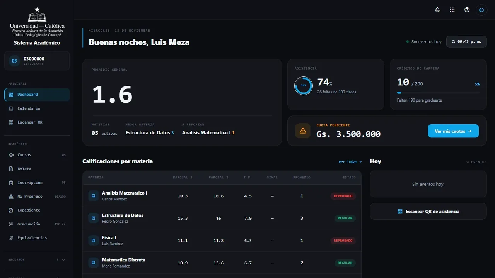
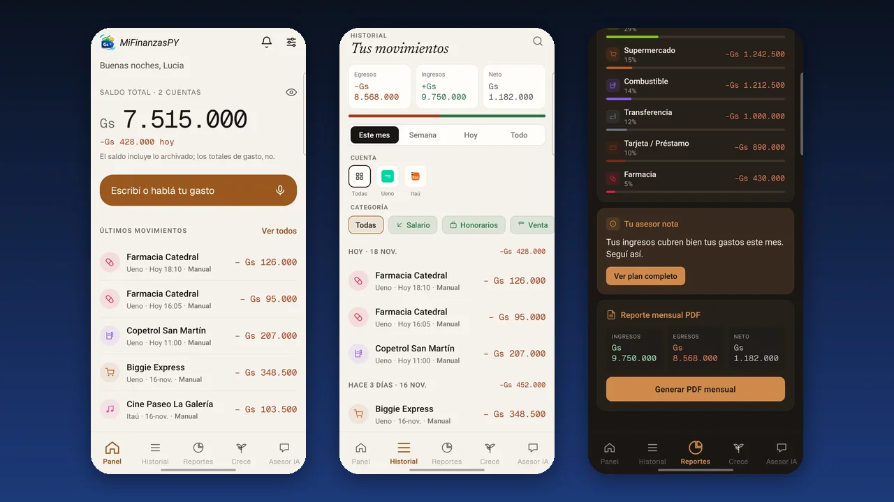
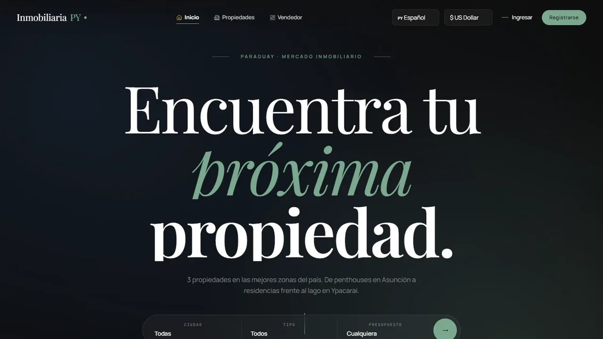
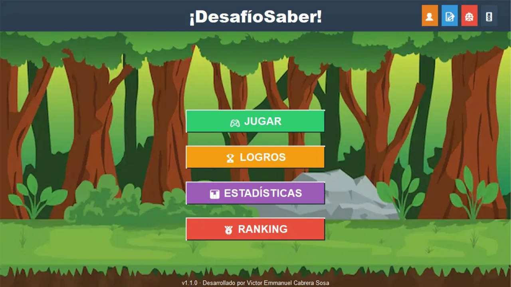
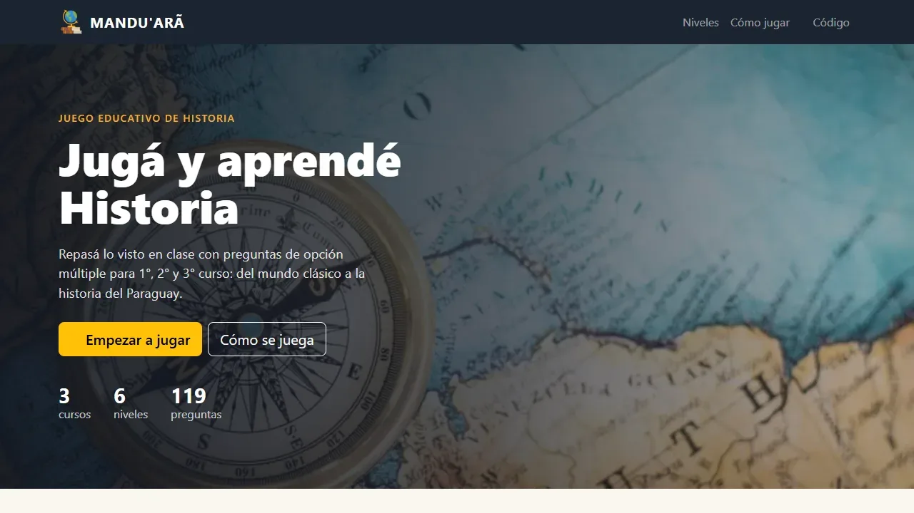
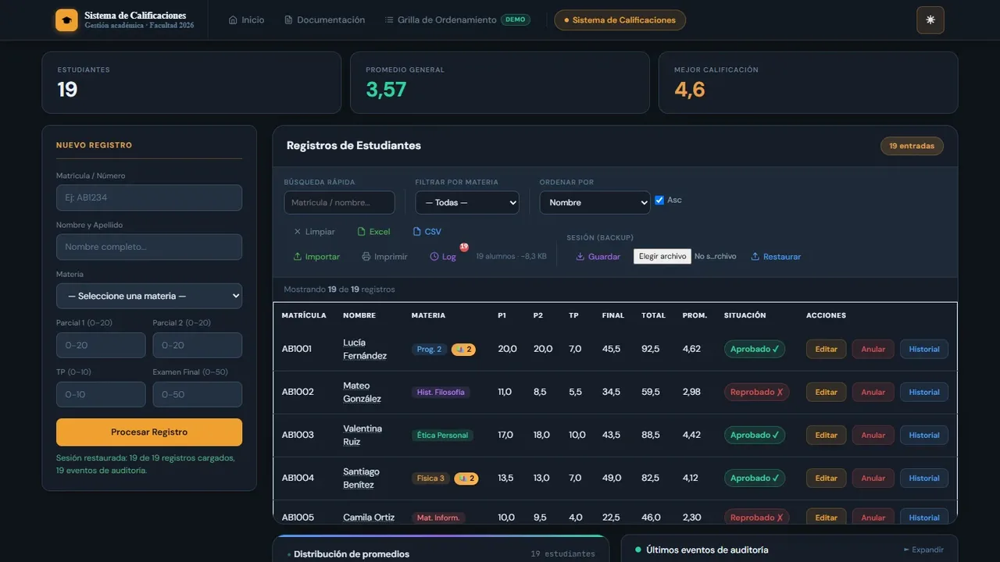

  Desarrollo <b>aplicaciones web y móviles de punta a punta</b>: API, base de datos, interfaz y app. 
  Estudiante de Ingeniería en Informática en Paraguay. Me enfoco en productos que resuelven problemas locales.

  
  
  

<table>
  <tr>
    <td valign="top"></td>
    <td valign="top"></td>
  </tr>
</table>

---

### Qué hago

<table>
  <tr>
    <td width="33%" valign="top">
      <b>Web full stack</b> 
      Next.js y React con TypeScript. Server Components, paneles por rol, pagos con Stripe y búsqueda semántica con IA.
    </td>
    <td width="33%" valign="top">
      <b>Apps móviles</b> 
      React Native con Expo. Apps offline-first con SQLite y builds de Android publicadas como APK.
    </td>
    <td width="33%" valign="top">
      <b>Backend y datos</b> 
      APIs REST con FastAPI y Flask, PostgreSQL con Supabase, autenticación con tokens de acceso y refresco, y tests automatizados.
    </td>
  </tr>
</table>

### Proyectos

<table>
  <tr>
    <td width="50%" valign="top">
      
      <h4>Sistema Académico <code>web + mobile</code></h4>
      Gestión académica para la UCA, sede Caacupé: portales de alumno, profesor y administrador, asistencia por QR y boletas en PDF. Tiene web y app móvil.  
      <b>FastAPI · PostgreSQL · React · Expo</b> &nbsp;·&nbsp; 399 tests en el backend 
      <a href="https://sistema-academico-alpha.vercel.app/login">Demo en vivo</a> · <a href="https://github.com/vecs0/sistema-academico-personal">Código</a>
    </td>
    <td width="50%" valign="top">
      
      <h4>MiFinanzasPY <code>mobile</code></h4>
      App Android de finanzas personales en guaraníes. Funciona sin conexión, registra gastos con texto libre o voz y trae 21 bancos y billeteras de Paraguay.  
      <b>React Native · Expo · SQLite · Cloudflare Workers</b> &nbsp;·&nbsp; 428 tests 
      <a href="https://github.com/vecs0/mifinanzaspy/releases/latest">Descargar APK</a> · <a href="https://github.com/vecs0/mifinanzaspy">Código</a>
    </td>
  </tr>
  <tr>
    <td width="50%" valign="top">
      
      <h4>InmobiliariaPY <code>web</code></h4>
      Plataforma inmobiliaria con paneles para compradores, vendedores y administradores, mapa interactivo, suscripciones con Stripe, búsqueda semántica con IA y API pública.  
      <b>Next.js · TypeScript · Supabase · Stripe · OpenAI</b> 
      <a href="https://github.com/vecs0/Inmobiliaria_py">Código</a>
    </td>
    <td width="50%" valign="top">
      
      <h4>DesafíoSaber <code>desktop + web</code></h4>
      Juego de trivia de escritorio con 3 modos y 760 preguntas. Incluye un panel de administración web que se sincroniza con el juego en tiempo real.  
      <b>Python · Flask · Socket.IO · React</b> &nbsp;·&nbsp; 40 tests 
      <a href="https://github.com/vecs0/DesafioSaber/releases/latest">Descargar .exe</a> · <a href="https://github.com/vecs0/DesafioSaber">Código</a>
    </td>
  </tr>
  <tr>
    <td width="50%" valign="top">
      
      <h4>MANDU'ARÃ <code>web</code></h4>
      Juego educativo de Historia para secundaria, del mundo clásico al Paraguay contemporáneo. Tiene 6 niveles y se juega desde el celular.  
      <b>HTML · CSS · JavaScript · Bootstrap</b> 
      <a href="https://vecs0.github.io/manduara.dev/">Jugar</a> · <a href="https://github.com/vecs0/manduara.dev">Código</a>
    </td>
    <td width="50%" valign="top">
      
      <h4>Sistema de Calificaciones <code>web</code></h4>
      Registro de alumnos y notas por materia con promedios automáticos, estadísticas del curso, auditoría de cambios y exportación a Excel y CSV.  
      <b>C# · ASP.NET Web Forms · Bootstrap</b> 
      <a href="https://github.com/vecs0/Gestion_calificaciones">Código</a>
    </td>
  </tr>
</table>

### Stack

| Área | Tecnologías |
|---|---|
| **Frontend** |  |
| **Mobile** |  &nbsp;React Native · Expo |
| **Backend** |  |
| **Datos y nube** |  |
| **Herramientas** |  |

### Cómo trabajo

- **Lo pruebo.** Mis proyectos grandes tienen tests automatizados: 428 en MiFinanzasPY y 399 en el backend del Sistema Académico.
- **Lo dejo listo para usar.** Publico demos en vivo, APK y ejecutables, para que se pueda probar sin compilar nada.
- **Lo documento.** Cada repositorio explica qué hace, cómo correrlo y cómo está armado, con capturas reales.

### Actividad

El mapa, el retrato ASCII y la ficha son SVG animados que genero con scripts propios en [`scripts/`](scripts). Un GitHub Action actualiza el mapa todos los días.

Paraguay · Abierto a oportunidades como desarrollador full stack o mobile

