  Desarrollo <b>aplicaciones web y móviles de punta a punta</b>: API, base de datos, interfaz y app. 
  Estudiante de Ingeniería en Informática. Me enfoco en productos que resuelven problemas locales.

<picture>
  <source media="(prefers-color-scheme: dark)" srcset="https://raw.githubusercontent.com/vecs0/vecs0/main/assets/hero-dark.svg">
  <source media="(prefers-color-scheme: light)" srcset="https://raw.githubusercontent.com/vecs0/vecs0/main/assets/hero-light.svg">
  
</picture>

 

<a href="https://github.com/vecs0?tab=repositories" title="Ver todos mis repositorios"><picture><source media="(prefers-color-scheme: dark)" srcset="https://raw.githubusercontent.com/vecs0/vecs0/main/assets/cards/heading-dark.svg"></picture></a>

  <a href="https://github.com/vecs0/sistema-academico-personal" title="Abrir el repositorio de Sistema Académico"><picture><source media="(prefers-color-scheme: dark)" srcset="https://raw.githubusercontent.com/vecs0/vecs0/main/assets/cards/sistema-academico-personal-dark.svg"></picture></a>
  <a href="https://github.com/vecs0/mifinanzaspy" title="Abrir el repositorio de MiFinanzasPY"><picture><source media="(prefers-color-scheme: dark)" srcset="https://raw.githubusercontent.com/vecs0/vecs0/main/assets/cards/mifinanzaspy-dark.svg"></picture></a>
  <a href="https://github.com/vecs0/Inmobiliaria_py" title="Abrir el repositorio de InmobiliariaPY"><picture><source media="(prefers-color-scheme: dark)" srcset="https://raw.githubusercontent.com/vecs0/vecs0/main/assets/cards/inmobiliaria-py-dark.svg"></picture></a>
  <a href="https://github.com/vecs0/DesafioSaber" title="Abrir el repositorio de DesafíoSaber"><picture><source media="(prefers-color-scheme: dark)" srcset="https://raw.githubusercontent.com/vecs0/vecs0/main/assets/cards/desafiosaber-dark.svg"></picture></a>
  <a href="https://github.com/vecs0/manduara.dev" title="Abrir el repositorio de MANDU'ARÃ"><picture><source media="(prefers-color-scheme: dark)" srcset="https://raw.githubusercontent.com/vecs0/vecs0/main/assets/cards/manduara-dev-dark.svg"></picture></a>
  <a href="https://github.com/vecs0/Gestion_calificaciones" title="Abrir el repositorio de Calificaciones"><picture><source media="(prefers-color-scheme: dark)" srcset="https://raw.githubusercontent.com/vecs0/vecs0/main/assets/cards/gestion-calificaciones-dark.svg"></picture></a>

 

<picture>
  <source media="(prefers-color-scheme: dark)" srcset="https://raw.githubusercontent.com/vecs0/vecs0/output/snake-dark.svg">
  <source media="(prefers-color-scheme: light)" srcset="https://raw.githubusercontent.com/vecs0/vecs0/output/snake-light.svg">
  
</picture>

 

<a href="https://github.com/dual-devs0/sistema-academico" title="Abrir el repositorio de Sistema Académico UCA">
<picture>
  <source media="(prefers-color-scheme: dark)" srcset="https://raw.githubusercontent.com/vecs0/vecs0/main/assets/featured-dark.svg">
  <source media="(prefers-color-scheme: light)" srcset="https://raw.githubusercontent.com/vecs0/vecs0/main/assets/featured-light.svg">
  
</picture>
</a>

  
  &nbsp;&nbsp;
  

 

&nbsp;&nbsp;

&nbsp;&nbsp;

Paraguay · Abierto a oportunidades como desarrollador full stack o mobile

